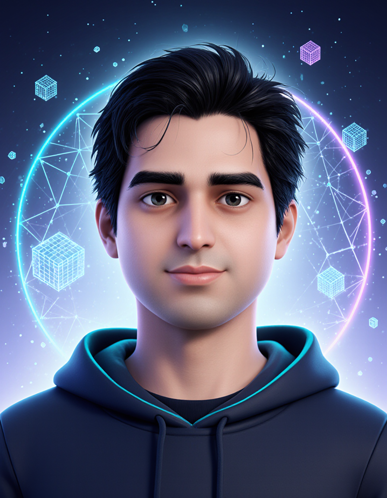

<!-- =========================================================
     AJIT KOHIR | GITHUB PROFILE
     Repository: koolkap/koolkap
     Avatar: my-image-3d-avatar.png
========================================================= -->

<!-- ================= FUTURISTIC HEADER ================= -->

  

# 👋 Hi, I'm Ajit Kohir!

### CTO · AI Engineer · Generative AI · RAG · 3D Web Experiences

*Building intelligent applications at the intersection of AI, software engineering, and interactive 3D technology.*

 

<!-- ================= FIXED PROFILE BADGES ================= -->

  

---

<!-- ================= ABOUT ME ================= -->

## ⚡ About Me

<table>
<tr>
<td width="65%" valign="top">

### 🚀 Engineer. Innovator. Builder.

I'm a technology leader passionate about turning emerging technologies into useful, real-world products.

- 🤖 Building generative AI applications and intelligent workflows
- 🧠 Exploring RAG, LLMs, and AI-powered assistants
- ☁️ Developing cloud-based AI solutions
- 🌐 Creating interactive 3D web experiences
- 🎓 Building technology for immersive learning
- 🛠️ Leading engineering teams and delivering products

**My philosophy:** Build things that solve real problems.

</td>
<td width="35%" align="center" valign="middle">

  

</td>
</tr>
</table>

---

<!-- ================= TECHNOLOGY STACK ================= -->

## 🧰 Technology Universe

### 💻 Languages & Frameworks

  

### ☁️ Cloud & Development

  

### 🧠 Specializations

---

<!-- ================= PROJECT SHOWCASE ================= -->

## 🔥 What I'm Building

<table>
<tr>
<td width="50%" valign="top">

### 🤖 Generative AI

Building AI-powered applications, intelligent assistants, and LLM-driven workflows.

**Focus**

Generative AI · AI Engineering · Prompt Engineering

</td>
<td width="50%" valign="top">

### 🧠 RAG & AI Systems

Exploring retrieval-augmented generation, document search, and context-aware assistants.

**Focus**

RAG · Embeddings · Vector Search · LLMs

</td>
</tr>
<tr>
<td width="50%" valign="top">

### 🌐 Interactive 3D

Creating browser-based 3D applications and immersive digital experiences.

**Focus**

Three.js · WebGL · WebGPU · WebXR

</td>
<td width="50%" valign="top">

### 🎓 EdTech Innovation

Developing interactive learning experiences that bring programming, creativity, and technology together.

**Focus**

Educational Technology · Interactive Learning · 3D Applications

</td>
</tr>
</table>

---

<!-- ================= AUTOMATED GITHUB ACTIVITY ================= -->

## 📡 Latest GitHub Activity

<!-- ACTIVITY_START -->
- **2026-10-18** — Pushed 0 commit(s) in [`koolkap/koolkap`](https://github.com/koolkap/koolkap)
- **2026-10-18** — Pushed 0 commit(s) in [`koolkap/koolkap`](https://github.com/koolkap/koolkap)
- **2026-10-18** — Pushed 0 commit(s) in [`koolkap/koolkap`](https://github.com/koolkap/koolkap)
- **2026-10-18** — Pushed 0 commit(s) in [`koolkap/koolkap`](https://github.com/koolkap/koolkap)
- **2026-10-18** — Pushed 0 commit(s) in [`koolkap/koolkap`](https://github.com/koolkap/koolkap)
- **2026-10-18** — Created a branch, tag, or repository in [`koolkap/koolkap`](https://github.com/koolkap/koolkap)
- **2026-10-18** — Pushed 0 commit(s) in [`koolkap/koolkap`](https://github.com/koolkap/koolkap)
- **2026-10-18** — Pushed 0 commit(s) in [`koolkap/koolkap`](https://github.com/koolkap/koolkap)
<!-- ACTIVITY_END -->

---

<!-- ================= CONTRIBUTION SNAKE ================= -->

## 🐍 Contributions in Motion

---

<!-- ================= GITHUB ANALYTICS ================= -->

## 📊 GitHub Analytics

  

---

<!-- ================= CONNECT ================= -->

## 🌍 Let's Connect

Interested in AI engineering, Generative AI, RAG, cloud technologies, or immersive 3D experiences?

 

  

### 💡 BUILD · EXPERIMENT · INNOVATE

*The future belongs to people who build it.*

